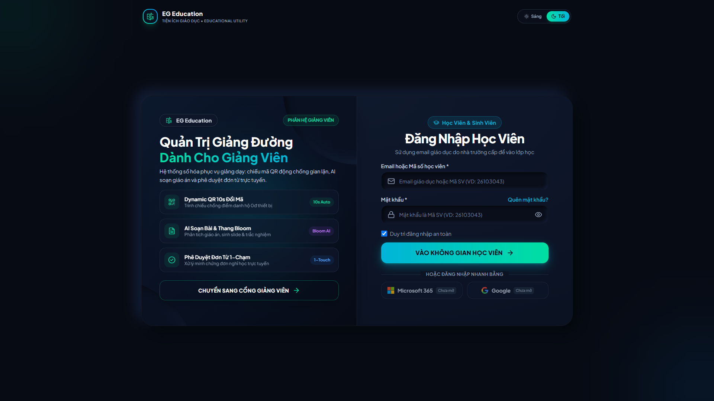
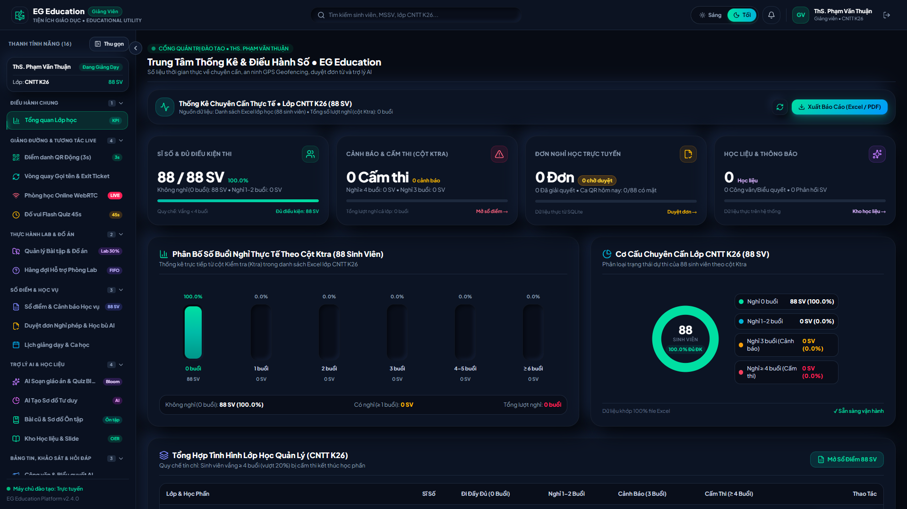
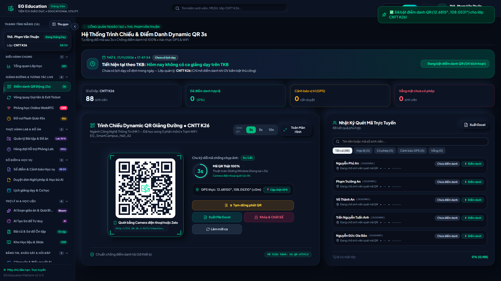
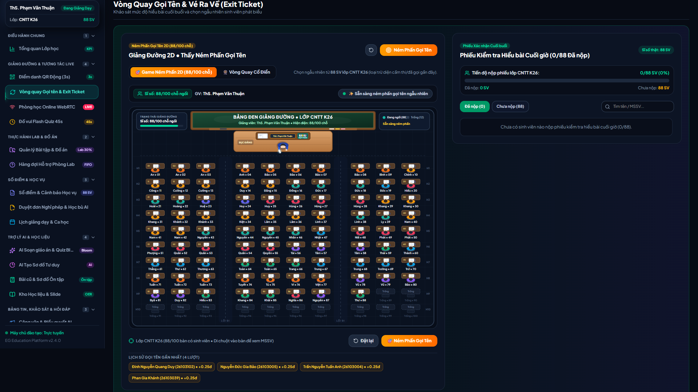
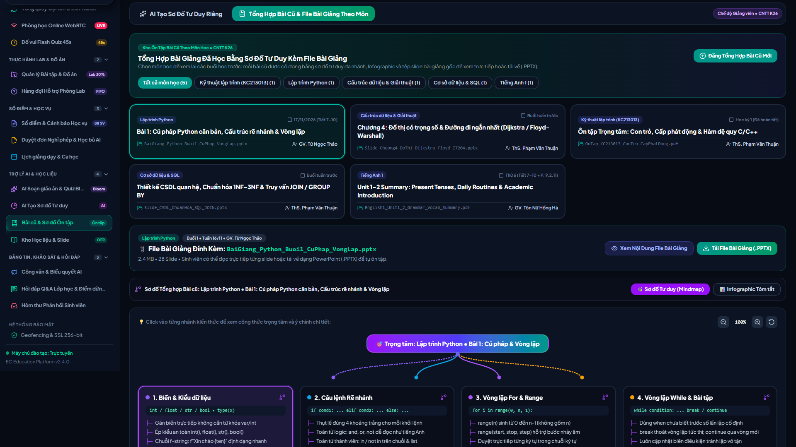
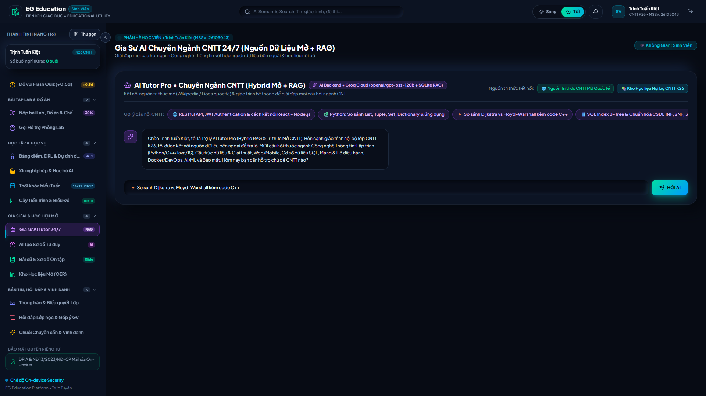

# 🎓 EG Education (Educational Gadget) – Hệ sinh thái Trợ giảng Số & Lớp học Thông minh

> **Dự án dự thi Cuộc thi CODE THE THANKS 2026** (*“Sáng tạo không giới hạn – Tri ân bằng công nghệ” • Chào mừng Ngày Nhà giáo Việt Nam 20/11/2026*) và **Cuộc thi Ý tưởng Khởi nghiệp năm 2026** – Trường Đại học Tây Nguyên.

🌐 **Trải nghiệm Trực tuyến (Live Demo HTTPS):** https://eg-education-web-production.up.railway.app

---

## 💡 Thông điệp Tri ân & Ý tưởng Cốt lõi

Lấy cảm hứng từ lòng biết ơn hướng về Ngày Nhà giáo Việt Nam 20/11, **EG Education** là món quà công nghệ của sinh viên **Lớp CNTT K26 – Khoa Khoa học Tự nhiên và Công nghệ, Trường Đại học Tây Nguyên** dành tặng Quý Thầy Cô.

Tại các giảng đường đông từ 80–100 sinh viên, Thầy Cô phải tiêu tốn nhiều thời gian cho việc điểm danh thủ công, kiểm soát bài thực hành, duyệt đơn từ và giải đáp thắc mắc lặp lại. **EG Education** số hóa trọn vẹn quy trình đó với **chi phí phần cứng 0 đồng**:
- **Điểm danh Dynamic QR đổi mã tự động `3s / 5s / 10s`** + **GPS Geofencing bán kính 50m** chống gian lận điểm danh hộ.
- **Game 2D “Thầy Ném Phấn Gọi Tên” (100 chỗ ngồi)** tái hiện không gian bục giảng thân thương, mang lại tiếng cười và sự hào hứng cho sinh viên phát biểu.
- **Hệ sinh thái AI Hybrid RAG 24/7**: AI Soạn giáo án Thang Bloom (`.PPTX`), AI Tạo Sơ đồ Tư duy độc lập, Kho Ôn tập Bài cũ theo môn bằng Sơ đồ Tư duy kèm File Bài giảng gốc (`.PPTX`/`.PDF`), Gia sư AI chuyên ngành CNTT và AI Tóm tắt Công văn + In Biên bản chuẩn Nghị định 30/2020/NĐ-CP.

> **Điều cả đội học được:** *“Trí tuệ nhân tạo dù hiện đại đến đâu cũng không thể thay thế trái tim và ánh mắt truyền lửa của người Thầy. Sứ mệnh đẹp nhất của tuổi trẻ công nghệ là gánh vác phần việc hành chính khô khan, trả lại cho Thầy Cô sự thảnh thơi nơi bục giảng.”*

---

## 👥 Nhóm Thực hiện (Lớp CNTT K26 – ĐH Tây Nguyên)

| Thành viên | MSSV | Vai trò & Đóng góp chính |
|---|---|---|
| **Trịnh Tuấn Kiệt** *(Đội trưởng)* | `26103043` | Kiến trúc tổng thể Full-stack, Backend Express 5 + SQLite, AI Hybrid RAG (`Groq Cloud`), Điểm danh Dynamic QR + GPS Geofencing, Game 2D Ném phấn, Triển khai Cloud Railway |
| **Võ Phương Vi** | `26103095` | Thiết kế UI/UX Dark/Light & Mobile-First (`390×844`), chuẩn hóa dữ liệu lớp `88` SV CNTT K26, Sổ điểm điện tử, Đơn nghỉ phép & Học bù AI, Kho ôn tập bài cũ |
| **Nguyễn Phú Đức** | `26103019` | Phân hệ Quản lý Lab, Đồ án nhóm CDIO (`Hệ số C_i`), Quét trùng code MOSS, Hàng đợi Phòng Lab FIFO, Công văn AI & Biểu quyết lớp học, Dựng video demo |

- **Giảng viên hướng dẫn & truyền cảm hứng**: **ThS. Phạm Văn Thuận** *(Giảng viên Khoa KHTN&CN, Trường Đại học Tây Nguyên)*

---

## 🔑 Tài khoản Trải nghiệm Nhanh (Cho Ban Giám Khảo)

Truy cập **https://eg-education-web-production.up.railway.app**, chọn phân hệ và bấm thẳng nút **Vào Không Gian** (hoặc nhập thông tin dưới đây):

- **Phân hệ Giảng Viên**: Email `pvthuan@eg.edu.vn` • Mật khẩu: `123456`
- **Phân hệ Học Viên / Sinh Viên**: Email `26103043@sv.ttn.edu.vn` • Mật khẩu: `26103043`

*(Lưu ý: Hai nút đăng nhập nhanh Google và Microsoft 365 đang được chủ động khóa kèm thông báo `"Chưa mở"` để minh bạch quy trình xác thực JWT nội bộ cho đến khi kết nối OAuth chính thức của nhà trường).*

---

## 🧩 16 Tính năng Lõi qua 6 Nhóm Nghiệp vụ

| Nhóm Nghiệp vụ | Phân hệ Giảng Viên | Phân hệ Sinh Viên |
|---|---|---|
| **1. Điều hành chung** | Tổng quan Lớp học (`88/88 SV`) & Xuất Báo cáo Điều hành (Excel/PDF) | Tổng quan Học tập & Tiến độ Cá nhân |
| **2. Giảng đường & Tương tác Live** | • Điểm danh QR Động (`3s/5s/10s`) + GPS 50m<br>• **Game 2D Ném Phấn Gọi Tên (100 ghế)** & Exit Ticket<br>• Phòng học Online WebRTC (`LIVE`)<br>• Đố vui Flash Quiz 45s | • Quét QR Camera + GPS 1-chạm<br>• Vé ra về (Exit Ticket) & Theo dõi Vòng quay<br>• Tham gia Phòng học Online WebRTC<br>• Trả lời Flash Quiz cộng điểm (`+0.5đ`) |
| **3. Thực hành Lab & Đồ án** | • Giao Lab, Đồ án nhóm (`C_i`), Quét MOSS & Chấm chéo<br>• Điều phối Hàng đợi Hỗ trợ Phòng Lab (`FIFO`) | • Nộp bài Lab, link GitHub & Chấm chéo đồng cấp<br>• Gọi Giảng viên hỗ trợ tại bàn Lab (`FIFO`) |
| **4. Sổ điểm & Học vụ** | • Sổ điểm Quá trình (`CC 20% + Lab 30% + GK 50%`) & Cảnh báo Cấm thi<br>• Duyệt đơn Nghỉ phép & Sinh gói Học bù AI<br>• Lịch giảng dạy & Nhận diện tiết TKB tự động | • Bảng điểm, Điểm RL & **Dự tính Điểm What-If**<br>• Xin nghỉ phép kèm minh chứng & Học bù AI<br>• Thời khóa biểu Tuần & **Cây Tiến trình HK1–HK8** |
| **5. Trợ lý AI & Học liệu Mở** | • AI Soạn giáo án Thang Bloom & Xuất `.PPTX`<br>• **AI Tạo Sơ đồ Tư duy** độc lập<br>• **Tổng hợp Bài cũ** theo môn (Mindmap + File `.PPTX`/`.PDF`)<br>• Kho Học liệu & Slide (OER) | • **Gia sư AI Tutor 24/7** (`Groq Cloud` • Hybrid RAG + Tri thức Mở ngành CNTT)<br>• AI Tạo Sơ đồ Tư duy bài học<br>• Xem lại **Bài cũ bằng Mindmap + Tải File Bài giảng**<br>• Kho Học liệu Mở (OER) |
| **6. Bản tin, Q&A & Vinh danh** | • AI Tóm tắt Công văn & Biểu quyết lớp<br>• Live Q&A lớp học & Điểm dừng Slide<br>• Hòm thư Phản hồi SV (có gợi ý AI) | • Studio Ban Cán Sự phát Công văn & Xuất Excel<br>• **In Biên bản Họp lớp chuẩn Nghị định 30/2020/NĐ-CP**<br>• Chuỗi Chuyên cần (Streak) & Bảng Vinh danh |

---

## 📸 Hình ảnh Thực tế Sản phẩm (`v2.4.0`)

| Cổng Đăng nhập Kép | Trung tâm Điều hành 88 SV |
|---|---|
|  |  |

| Điểm danh Dynamic QR 3s + GPS 50m | Game Lớp học 2D Ném Phấn (100 ghế) |
|---|---|
|  |  |

| Tổng hợp Bài cũ Mindmap + File Slide | Gia sư AI Tutor Pro 24/7 (Hybrid RAG) |
|---|---|
|  |  |

---

## 🛠️ Kiến trúc Kỹ thuật & Công khai Công cụ AI

- **Frontend**: React 19, Vite 6, Tailwind CSS v4, Lucide Icons, `qrcode.react`, `html5-qrcode`, `xlsx`, `pptxgenjs`.
- **Backend**: Node.js, Express 5 (`server/index.js` v2.4.0) phục vụ hợp nhất REST API (`/api/*`) và Static SPA (`dist/`).
- **Database**: SQLite (`better-sqlite3`) cấu hình `DB_PATH` lưu bền vững trên Volume Cloud (`/data/eg_education.db`).
- **AI Engine trong ứng dụng**: Groq Cloud API (`openai/gpt-oss-120b`) kết hợp SQLite Hybrid RAG & Tri thức Mở CNTT cho 4 chức năng (*Gia sư AI 24/7, AI Soạn bài Thang Bloom, AI Tạo Sơ đồ Tư duy, AI Tóm tắt Công văn*).
- **Công cụ hỗ trợ phát triển**: Trợ lý lập trình AI dùng để tối ưu responsive mobile và rà soát lỗi cú pháp; giọng đọc video demo dùng `Google TTS (vi)`; toàn bộ kiến trúc hệ thống, mã nguồn, nghiệp vụ sư phạm và kiểm thử do nhóm **EG Tech – CNTT K26** trực tiếp xây dựng và xác thực.

---

## 💻 Hướng dẫn Chạy Cục bộ (Local Development)

```bash
# 1. Cài đặt thư viện
npm install

# 2. Cấu hình biến môi trường (copy từ .env.example)
cp .env.example .env

# 3. Khởi chạy đồng thời Backend API (:5000) & Frontend Vite (:5173)
npm run dev

# Hoặc build bản Production hợp nhất
npm run build
npm start
```

---

*“CODE THE THANKS – Nơi sáng tạo được ghi nhận, nơi tri ân còn mãi.”*
