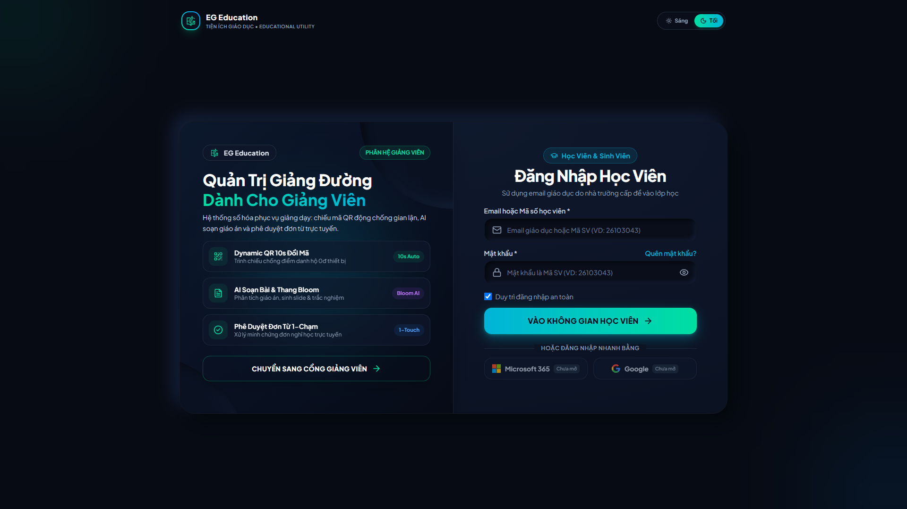
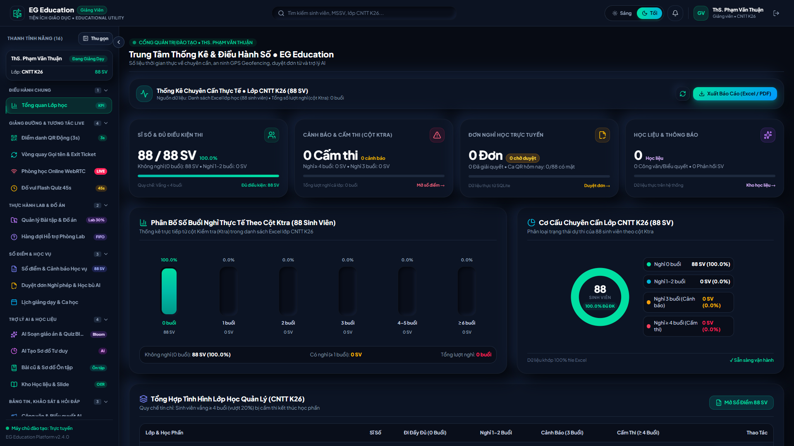
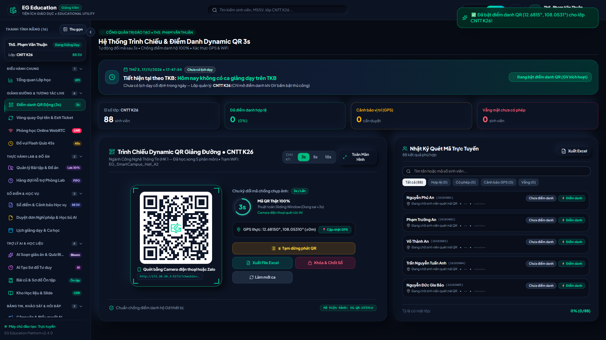
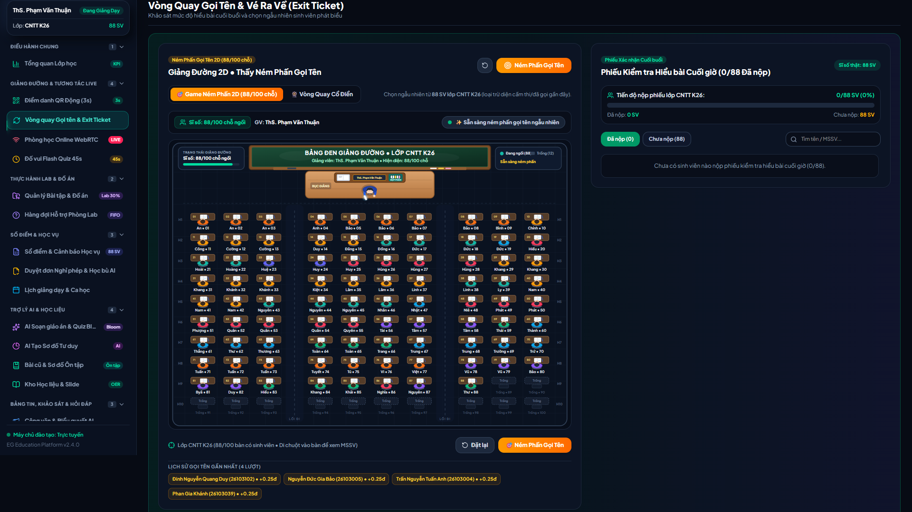
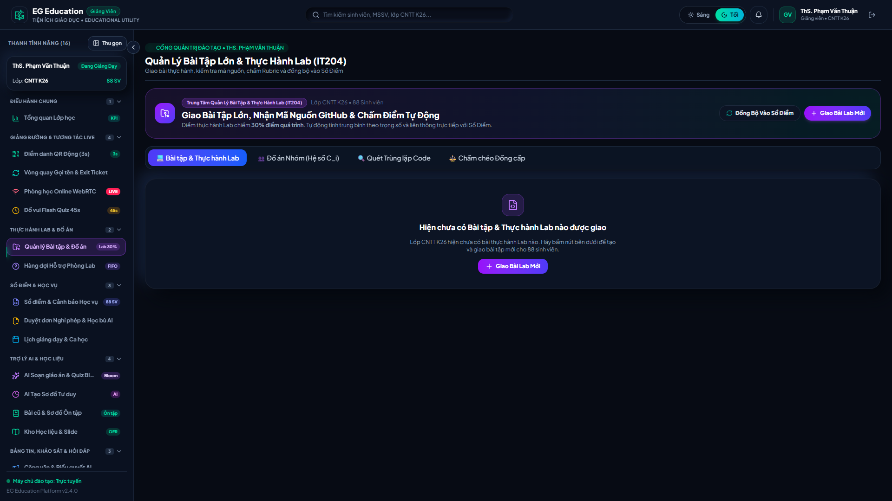
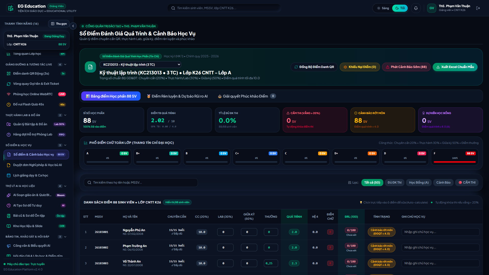
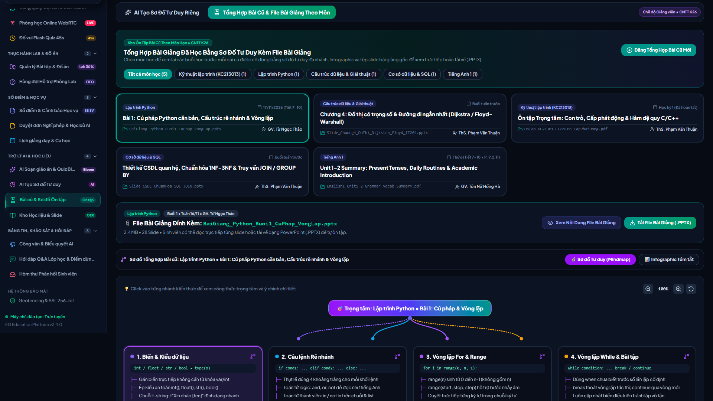
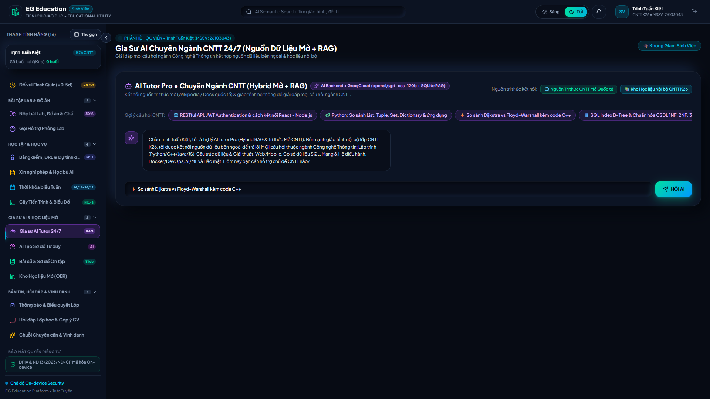
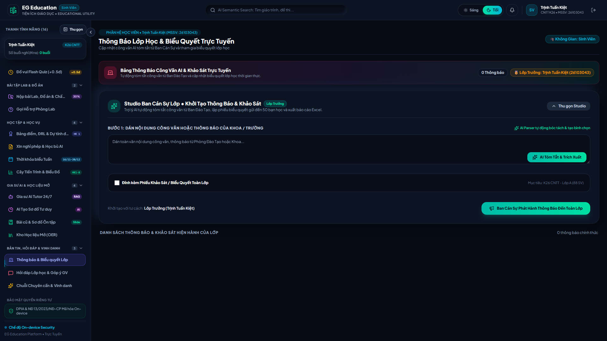
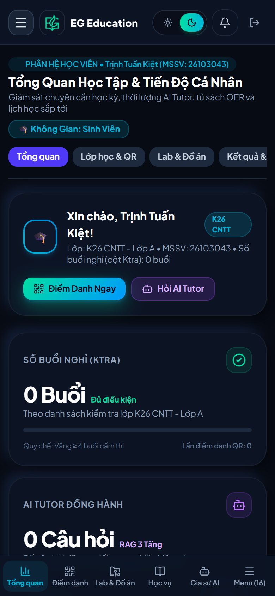

# HỒ SƠ THUYẾT MINH TÍNH NĂNG HỆ THỐNG NỘP BAN GIÁM KHẢO
## Dự án: EDUCATIONAL GADGET (EG EDUCATION) • Cuộc thi Ý tưởng Khởi nghiệp năm 2026

- **Đơn vị**: Trường Đại học Tây Nguyên • Khoa Khoa học Tự nhiên và Công nghệ (Lớp CNTT K26)
- **Nhóm tác giả**: **Trịnh Tuấn Kiệt** (`26103043` - Lập trình & triển khai toàn bộ hệ thống), **Nguyễn Quốc Phát** (Bổ sung tính năng, làm video báo cáo & kiểm thử sản phẩm), **Nguyễn Thị Hương Huệ** (Tìm hiểu tài chính & viết báo cáo)
- **Giảng viên hướng dẫn**: **ThS. Phạm Văn Thuận**
- **Link triển khai thực tế (Live HTTPS)**: https://eg-education-web-production.up.railway.app
- **Tài khoản Demo BGK**: Giảng viên `pvthuan@eg.edu.vn` (`123456`) | Sinh viên `26103043@sv.ttn.edu.vn` (`26103043`)

---

## I. Đặt vấn đề & 3 Điểm Đột phá Cốt lõi
1. **Điểm danh 0đ thiết bị phần cứng**: Thay thế máy quét vân tay/FaceID đắt đỏ bằng **Dynamic QR đổi mã 3s/5s/10s** kết hợp **GPS Geofencing bán kính 50m** chống gian lận.
2. **Trợ lý AI Agent Hybrid RAG 24/7 + Ôn tập Sơ đồ Tư duy**: Vận hành trên **Groq Cloud (`openai/gpt-oss-120b`)**, tách bạch **AI Tạo Sơ đồ Tư duy độc lập** với **Kho Tổng hợp Bài cũ theo môn bằng Sơ đồ Tư duy kèm File Bài giảng gốc (`.PPTX`/`.PDF`)**.
3. **Số hóa toàn diện 16 tính năng trên Desktop & Mobile**: Kết hợp **Game 2D Lớp học Ném Phấn Gọi Tên (88/100 chỗ ngồi)**, Lab/CDIO + MOSS + Chấm chéo, Sổ điểm What-If + ĐRL + Học bù AI, Công văn AI + Xuất Biên bản Nghị định 30/2020/NĐ-CP và **Giao diện Mobile 390×844 tối ưu**.

---

## II. Thuyết minh 16 Tính năng Lõi qua 6 Nhóm Nghiệp vụ
| Nhóm | Phân hệ Giảng Viên | Phân hệ Sinh Viên |
|---|---|---|
| **1. Điều hành chung** | Tổng quan Lớp học & Xuất Báo cáo Excel/PDF | Tổng quan Học tập & Tiến độ Cá nhân |
| **2. Giảng đường Live** | Dynamic QR (3s/5s/10s), Game 2D Ném Phấn (100 ghế), WebRTC, Flash Quiz 45s | Quét QR + GPS 1-chạm, Vé ra về Exit Ticket, WebRTC, Flash Quiz (+0.5đ) |
| **3. Lab & Đồ án CDIO** | Giao Lab/Đồ án (`C_i`), Quét trùng Code MOSS, Chấm chéo, Hàng đợi Lab FIFO | Nộp Lab/GitHub, Chấm chéo đồng cấp, Gọi hỗ trợ phòng Lab |
| **4. Sổ điểm & Học vụ** | Sổ điểm 88 SV, Cảnh báo Cấm thi, Duyệt đơn & Sinh gói Học bù AI, Lịch dạy | Bảng điểm & Dự tính What-If, Điểm RL, Học bù AI, TKB Tuần, Cây Tiến trình HK1–HK8 |
| **5. Trợ lý AI & OER** | AI Soạn bài Thang Bloom (`.PPTX`), AI Tạo Mindmap, Đăng Bài cũ kèm File, Kho Slide | Gia sư AI Tutor Mở toàn ngành CNTT, AI Tạo Mindmap, Xem Bài cũ kèm File, Kho OER |
| **6. Bản tin & Vinh danh** | AI Tóm tắt Công văn, Live Q&A / Điểm dừng Slide, Hòm thư Giải đáp AI | Ban Cán Sự phát Công văn & Biểu quyết, In Biên bản NĐ 30, Chuỗi Chuyên cần |

### Hình ảnh Thực tế Sản phẩm (Bản triển khai v2.4.0)

**Cổng đăng nhập kép Giảng Viên / Học Viên (Khóa minh bạch SSO Microsoft 365 & Google)**

**Trung tâm Điều hành Thống kê Chuyên cần Lớp CNTT K26 (88/88 SV)**

**Hệ thống Điểm danh Dynamic QR 3s chống chụp ảnh & xác thực GPS**

**Trò chơi Lớp học 2D Thầy Ném Phấn Gọi Tên (88/100 ghế) & Exit Ticket**

**Quản lý Bài tập Lab, Đồ án Nhóm CDIO, Quét MOSS & Chấm chéo**

**Sổ điểm Quá trình liên thông Chuyên cần QR & Cảnh báo Học vụ**

**Tổng hợp Bài cũ theo Môn bằng Sơ đồ Tư duy kèm File Bài giảng (.PPTX/.PDF)**

**Gia sư AI Tutor Pro 24/7 (Groq Cloud • Hybrid RAG + Tri thức mở ngành CNTT)**

**AI Tóm tắt Công văn & Biểu quyết Lớp học chuẩn Nghị định 30/2020/NĐ-CP**

**Giao diện Mobile tối ưu (Header gọn, Thanh 6 nút đáy & Drawer 16 tính năng)**

---

## III. Tóm tắt Kịch bản Thuyết trình 3 Phút & Phản biện Ban Giám Khảo
- **00:00 – 00:35**: Bài toán lớp đông 88–100 SV & Giải pháp 0đ phần cứng **Educational Gadget**.
- **00:35 – 01:25**: Demo **Dynamic QR 3s + GPS 50m** & **Game 2D Ném Phấn Gọi Tên 100 ghế**.
- **01:25 – 02:20**: Demo **Gia sư AI Tutor mở toàn ngành CNTT**, **Mindmap Bài cũ kèm file bài giảng**, **Công văn AI & Biên bản Nghị định 30**.
- **02:20 – 03:00**: Demo trực tiếp trên **Mobile 390×844** qua link Railway Cloud & Mô hình Doanh thu B2B (`15.000–20.000đ/SV/năm`) + B2C (`29.000đ/tháng`).
